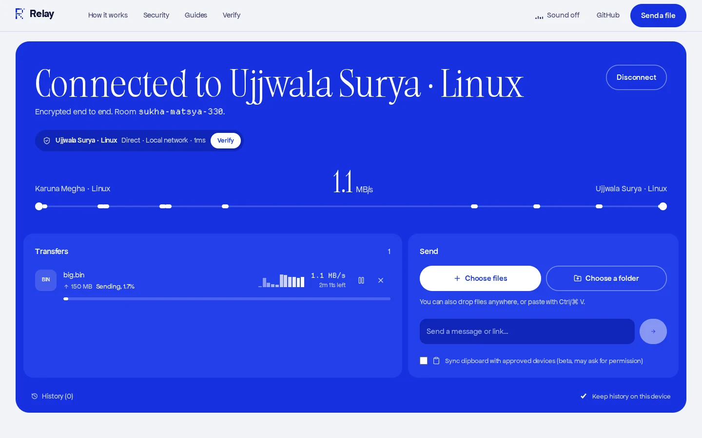
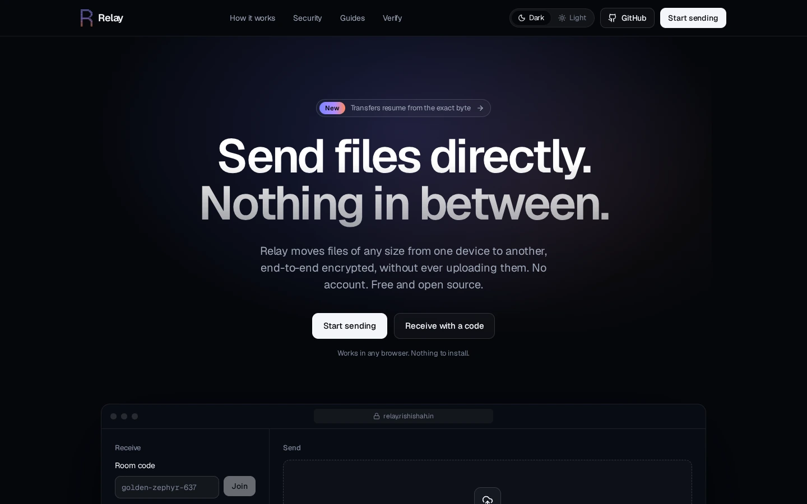
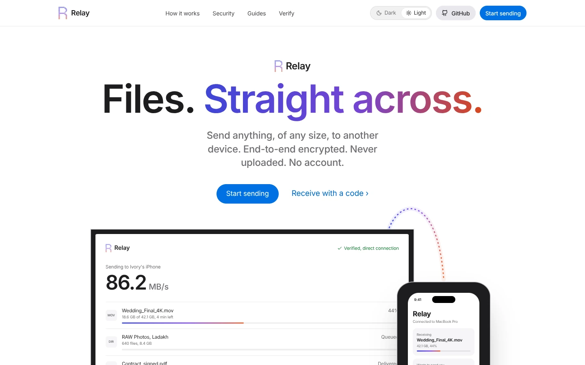
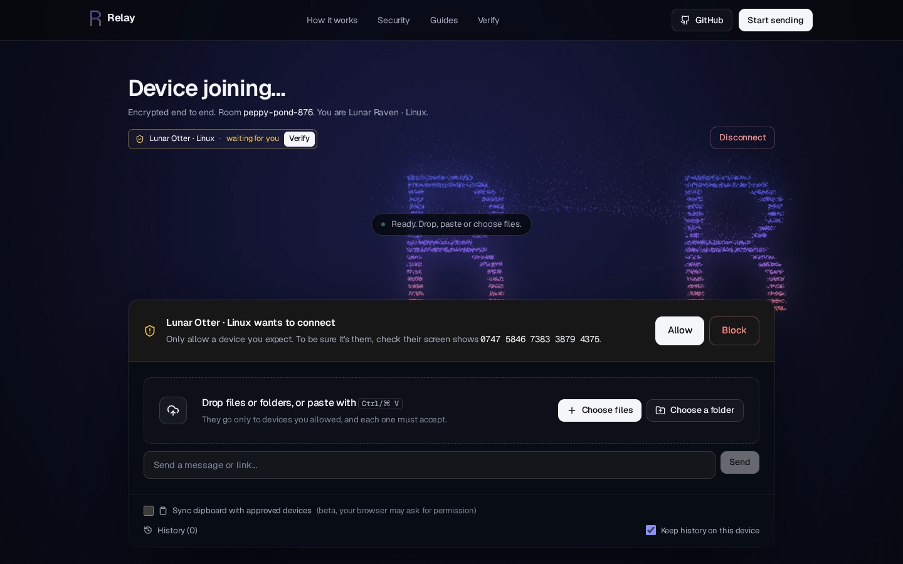
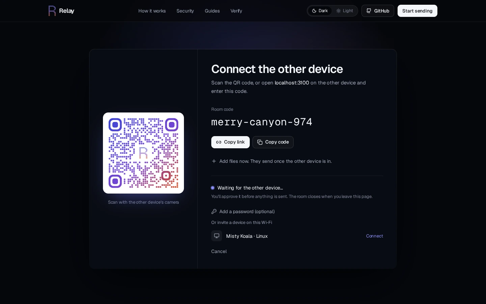
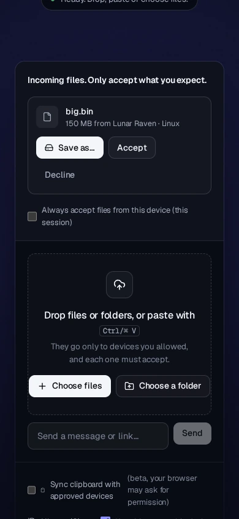

<p align="center">

</p>

<h1 align="center">Relay — free, open-source P2P file transfer</h1>

<p align="center">
  <b>Send files of any size directly between devices, in the browser.</b><br/>
  Peer-to-peer · end-to-end encrypted · no upload · no account · no size limit
</p>

<p align="center">
  <a href="https://relay.rishishah.in"><b>Open Relay →</b></a> ·
  <a href="#features">Features</a> ·
  <a href="#security">Security</a> ·
  <a href="#self-hosting">Self-hosting</a> ·
  <a href="#how-it-compares">Compare</a> ·
  <a href="https://relay.rishishah.in/articles">Guides</a>
</p>

<p align="center">
  <a href="LICENSE"></a>
  
  
  <a href="https://uptime.betterstack.com/?utm_source=status_badge"></a>
  <a href="https://deepwiki.com/byrishi/Relay"></a>
</p>

<p align="center">
  <a href="https://peerlist.io/rishhishah/project/relay" target="_blank" rel="noreferrer"></a>
</p>

<p align="center"></p>

## What is Relay?

Relay is a web app that sends files **straight from one device to another** over an encrypted WebRTC connection. Nothing is uploaded to a server, so there is no file size limit, no account, and no copy left in the cloud. It runs in any modern browser on Windows, macOS, Linux, Android, iPhone and iPad.

**How to use it:** open [relay.rishishah.in](https://relay.rishishah.in) and drop your files (or press **Start sending**). Share the code (`amber-fox-123`) or scan the QR code on the other device, or tap it under **Nearby**. Approve it, and the files go straight across.

## Features

**Transfer**
- Direct peer-to-peer transfer over WebRTC, with accurate progress, speed and ETA
- **No size limit.** Chrome and Edge stream straight to disk with *Save as…*
- **Resume** after a dropped connection from the exact byte where it stopped
- **Folders** keep their structure: save into a folder, or download as a ZIP (ZIP64 for huge sets)
- Paste to send (screenshots, files, text), plus clipboard sync (beta)
- Several files queue and send one at a time, so they never corrupt each other

**Connect**
- Readable room codes, branded QR codes and invite links
- Pick files first: they are sent as soon as you approve the other device
- **Nearby devices** on the same network, no code needed
- Optional room password
- Connection badge: *Direct · Local network*, *Direct · Peer-to-peer* or *Relayed via TURN*

**Control and privacy**
- **Approve** every device that joins and **accept** every file before a byte is sent
- **Safety number** on both screens to rule out a man-in-the-middle
- No accounts, no analytics, no ads; random device names
- Local transfer history (names and sizes only), which you can turn off or clear

**App**
- Installable PWA with **Share to Relay** from the Android share sheet
- Two designs, **Dark** and **Light**, with a switch in the header (or link straight to one with `?design=light`)
- While connected, both devices' marks are joined by a stream of light that follows live speed (WebGL2)
- Self-hostable: one Node.js server or one Docker container

<table>
<tr>
<td></td>
<td></td>
</tr>
<tr>
<td></td>
<td></td>
</tr>
<tr>
<td></td>
<td align="center"></td>
</tr>
</table>

## Security

| Layer | What it does |
|---|---|
| WebRTC DTLS | Every file, message and clipboard text is encrypted between the browsers with keys created on the devices |
| Safety number | Hash of both certificate fingerprints, shown on both screens. Matching numbers mean nobody, including the server, is in the middle |
| Approval + accept | New devices must be allowed, and each file must be accepted |
| Room codes | About 54M codes; 12 wrong guesses per IP per 10 min, then blocked; optional password (scrypt) |
| Server | Signaling scoped to the room, in-memory only, no file data, strict CSP, short-lived TURN credentials |

**Not protected:** your peer sees your IP address; malware on either device; files you choose to accept. Full threat model and the October 2026 review: [SECURITY.md](SECURITY.md) · [relay.rishishah.in/security](https://relay.rishishah.in/security).

## How it compares

| | Relay | WeTransfer (free) | LocalSend | PairDrop | AirDrop |
|---|---|---|---|---|---|
| Runs in | Browser | Browser | Native app | Browser | Apple devices |
| File stored on a server | Never | Until it expires | Never | Never | Never |
| Size limit | None | 3 GB per 30 days | None | None | None |
| Across the internet | ✓ | ✓ | Local network only | ✓ | Nearby only |
| Verify encryption | Safety number | — | PIN | — | — |
| Resume after drop | ✓ | — | — | — | — |
| Open source | MIT | — | Apache-2.0 | GPL-3.0 | — |

More: [best P2P file sharing apps](https://relay.rishishah.in/best-p2p-file-sharing-apps) · [Relay vs WeTransfer](https://relay.rishishah.in/relay-vs-wetransfer) · [Relay vs LocalSend](https://relay.rishishah.in/relay-vs-localsend) · [AirDrop alternative](https://relay.rishishah.in/airdrop-alternative)

## Self-hosting

**Docker**
```bash
git clone https://github.com/byrishi/Relay.git && cd Relay
docker build -t relay .
docker run -d -p 3000:3000 -e TRUST_PROXY=1 relay
```

**Render:** the repo includes `render.yaml`. Create a Blueprint from your fork. **Node 20+:** `npm ci --include=dev && npm run build && NODE_ENV=production npm start`.

Serve it over HTTPS (Caddy, Nginx or your platform), since browsers require a secure origin.

| Variable | Purpose |
|---|---|
| `PORT` | Listen port (default 3000) |
| `TRUST_PROXY` | Proxies in front of Node (Render, Fly, Nginx = 1). Required for correct per-visitor rate limits. Default 1 in production |
| `ALLOWED_ORIGINS` | Comma-separated origins if the frontend is on another domain |
| `TURN_SECRET`, `TURN_URLS` | TURN with short-lived credentials (coturn `use-auth-secret`) |
| `VITE_BACKEND_URL` | Build-time: signaling server URL if the frontend is hosted separately |

`GET /healthz` returns `ok`. Full guide: [self-hosted file sharing](https://relay.rishishah.in/self-hosted-file-sharing).

## Development

```bash
npm install
npm run dev        # http://localhost:3000 (Vite + signaling server)
npm run typecheck  # TypeScript, no emit
npm run build      # client + prerendered pages + server bundle
```

### Project layout

```
server.ts                  signaling server (Socket.IO), rate limits, CSP, TURN credentials, static/SEO serving
src/lib/webrtc.ts          transfer engine: offers, flow control, resume, safety number
src/lib/sinks.ts           where received bytes go (disk, folder, OPFS, memory) + ZIP builder
src/hooks/useRelay.ts      session logic: rooms, peers, approvals, nearby devices
src/components/            UI, including the WebGL2 Atmosphere scene
content/                   guides and pages in Markdown (one source for app, SEO and AI)
scripts/prerender.ts       builds static HTML per page, .md copies, llms.txt, sitemap
```

### Content and SEO

Every guide is a Markdown file in `content/articles/` with front matter (`title`, `description`, `h1`, `category`, `keywords`, `related`). At build time `scripts/prerender.ts`:

- renders each page to static HTML with its own title, description, canonical URL, Open Graph tags and JSON-LD (`WebApplication`, `Article`, `FAQPage`, `BreadcrumbList`), so search engines and AI crawlers see full content without JavaScript;
- writes a clean `.md` copy of every page (`/index.md`, `/security.md`, …), also served when a client sends `Accept: text/markdown`;
- generates [`/llms.txt`](https://relay.rishishah.in/llms.txt), `/llms-full.txt` and `/sitemap.xml`;
- fails the build on broken internal links, duplicate titles or over-long descriptions.

Old URLs redirect (301) through `content/redirects.json`.

## Limitations

- Both devices must be online during the transfer; Relay stores nothing.
- Very strict networks (some offices, universities, mobile carriers) need a TURN relay.
- Save-straight-to-disk needs Chrome or Edge on desktop; other browsers buffer in browser storage first.
- Choosing a folder to send needs a desktop browser.

## Contributing

Issues and pull requests are welcome; see [CONTRIBUTING.md](CONTRIBUTING.md). Please report security issues privately (see [SECURITY.md](SECURITY.md)). Release notes are in [CHANGELOG.md](CHANGELOG.md).

## License

[MIT](LICENSE) © Relay contributors. Built by [Rishi Shah](https://rishishah.in).
